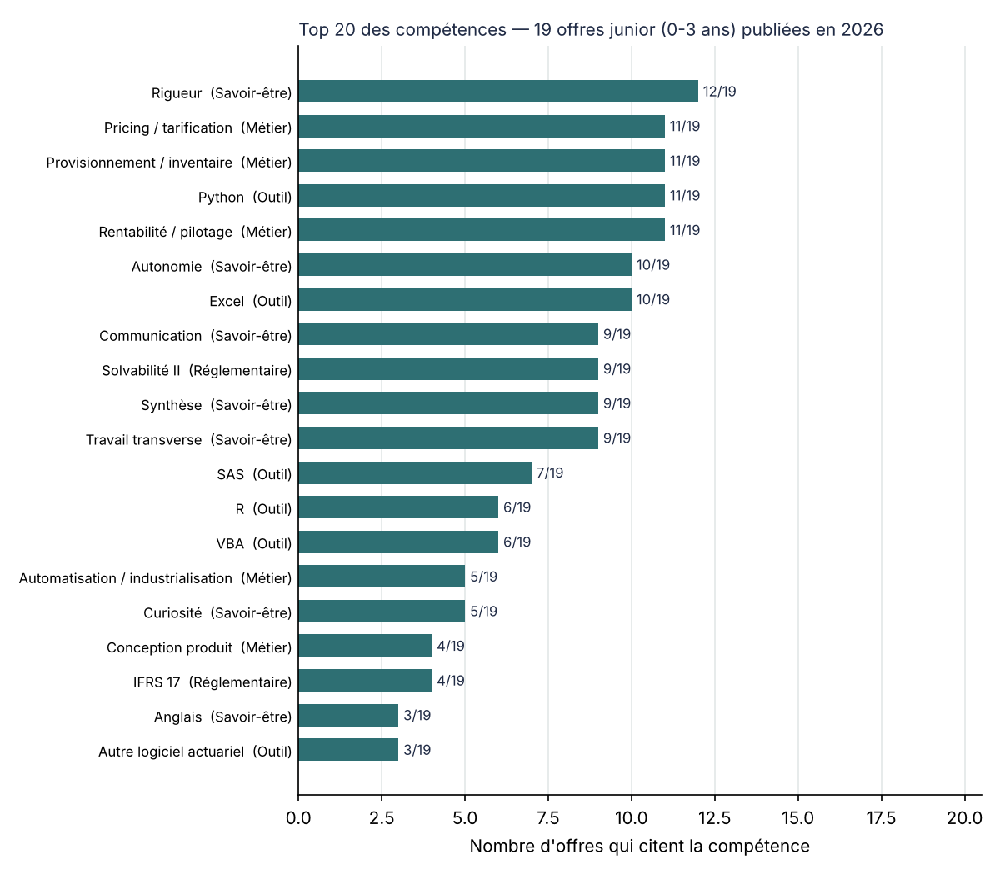
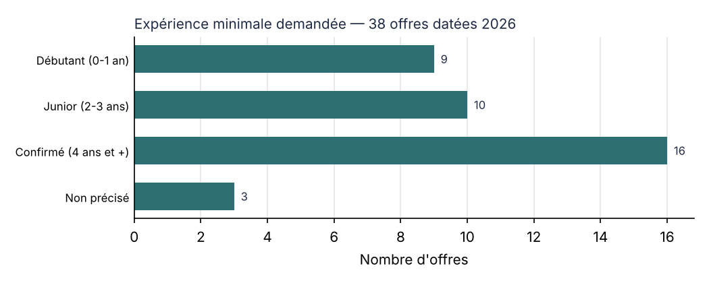

# Actuarial Jobs Skills Map

> Que demande vraiment le marché à un actuaire **junior** en France en 2026 ? Analyse de 50 offres d'emploi, dont 38 publiées en 2026 et 19 accessibles avec 0 à 3 ans d'expérience.

*Projet n°0 du programme **ACTUARY DISCOVERY** : 1 sujet par semaine, 1 mini-projet reproductible.*



## Le problème
Un jeune actuaire doit choisir quoi approfondir en premier, et sur quoi se différencier pour progresser. Ce dépôt transforme des offres réelles en une **matrice compétences × offres**, puis compare ce qui est demandé à l'entrée avec ce qui est demandé aux profils confirmés.

## Résultats clés



**1. Le marché junior existe, mais il est étroit.** Sur 38 offres datées de 2026, 19 sont accessibles avec 0 à 3 ans d'expérience. Seules 9 acceptent un profil débutant (0 à 1 an) et 16 demandent 4 ans ou plus. Les intitulés trompent : plusieurs « chargé d'études actuarielles » exigent en réalité 5 ans.

**2. Ce qui est demandé dès l'entrée (19 offres junior) :**

| Catégorie | Compétences les plus citées (nombre d'offres sur 19) |
|---|---|
| Métier | Pricing / tarification (11) · **Provisionnement / inventaire (11)** · Rentabilité / pilotage (11) |
| Outils | Python (11) · Excel (10) · SAS (7) · R (6) · VBA (6) |
| Réglementaire | Solvabilité II (9) · IFRS 17 (4) |
| Savoir-être | Rigueur (12) · Autonomie (10) · Communication, Synthèse, Travail transverse (9) |

**3. Ce qui fait la différence en progressant** (part des offres confirmées moins part des offres junior, `reports/junior_vs_confirme.csv`) :

| Compétence | Junior | Confirmé | Écart |
|---|---|---|---|
| Reporting / dashboards | 16 % | 44 % | +28 pts |
| Contrôles / fiabilisation des données | 11 % | 31 % | +21 pts |
| Travail transverse | 47 % | 69 % | +21 pts |
| Modèles de projection | 5 % | 25 % | +20 pts |
| Automatisation / industrialisation | 26 % | 44 % | +18 pts |
| ORSA | 11 % | 25 % | +15 pts |

**4. Le machine learning n'est presque jamais exigé explicitement à l'entrée** (1 offre junior sur 19). Les attentes portent d'abord sur les fondamentaux : tarifer, provisionner, suivre la rentabilité.

**Un chiffre, une décision :** pour un junior, l'inventaire est demandé aussi souvent que le pricing (11 offres sur 19). L'inventaire ne peut donc pas rester une simple « notion » dans mon plan de formation.

### Lecture proposée par l'IA [Claude]
- Le socle junior tient en trois briques : **tarifer, provisionner, piloter la rentabilité**, avec Python et Excel.
- Pour progresser, il faut ensuite savoir **fiabiliser, automatiser et restituer** (reporting). Ces compétences correspondent exactement aux problématiques observées sur le terrain : jointures, contrôles, reporting de rentabilité.
- Les offres junior en réassurance sont rares (3 sur 19) mais réelles : Aon, Diot Siaci, Arundo Re.

### Ma lecture [Laurice]
- Surprise : l'automatisation, la fiabilisation et le reporting ressortent davantage dans les offres confirmées. Je m'attendais à l'inverse, car les jeunes diplômés sortent formés à ces outils. Un test de Fisher montre que ces écarts ne sont pas significatifs (p > 0,1) avec 19 offres junior et 16 confirmées : c'est une tendance à confirmer sur un échantillon plus large. Mon hypothèse : les offres confirmées décrivent la responsabilité de ces sujets, pas seulement leur exécution.
- La rigueur est exigée à tous les niveaux (12 offres junior sur 19) : une erreur de jointure ou de filtre coûte cher, quel que soit le niveau.
- Décision : je place l'inventaire juste après le pricing dans mon plan de formation, car il est demandé aussi souvent (11 offres sur 19).

## Volet technique
- **Collecte (28/10/2026)** : 34 offres nouvelles, extraites de l'espace emploi Agefiph, de Welcome to the Jungle et de Wizbii, plus les 16 offres de la première version. Seules les offres encore en ligne sont accessibles : les offres retirées depuis janvier ne peuvent pas être récupérées.
- **Périmètre d'analyse** : uniquement les offres dont la publication en 2026 est vérifiée (`date_2026_verified`). Les offres sans date visible restent dans les données, mais sont exclues des calculs.
- **Niveaux d'expérience** : Débutant (0-1 an), Junior (2-3 ans), Confirmé (4 ans et plus, ou « expérience confirmée / significative »), Non précisé.
- **Codage** : 43 compétences réparties en 4 catégories. Une compétence est comptée dès qu'elle est citée, même « en plus ».
- **Contrôles avant calcul** (`analyze.check`) : identifiants et URL uniques, aucune compétence orpheline, aucune offre sans compétence, pas de doublon, catégories et niveaux valides, cohérence entre niveau et nombre d'années.

## Volet opérationnel
- **Pour qui** : un actuaire junior qui construit son plan de formation, ou un manager qui veut comparer ses fiches de poste au marché.
- **Décision éclairée** : l'ordre des mini-projets du programme ACTUARY DISCOVERY et les compétences à mettre en avant en candidature.
- **Mise à jour** : ajouter des lignes dans `collecte/raw_collecte.tsv`, puis lancer `python collecte/build_dataset.py && python src/analyze.py`.

## Vérifications réalisées
- `tests/test_data.py` : intégrité des données, règles du périmètre junior (date 2026 et 3 ans au plus), recalcul manuel d'une fréquence, cohérence entre la matrice et la table longue.
- **Contre-vérification par l'IA** : 3 offres (Groupama Lyon, CNP Angers, MACIF Niort) relues avec une question différente. Le codage est cohérent sur les 3. Une omission corrigée sur CNP Angers (outil interne et mention de l'IA).
- **Relecture humaine** : 3 offres vérifiées(Aon, DIOT-CIACI , MACIF Niort). Toute est cohérent.

## Limites
- **50 offres au lieu des 100 visées.** Le marché junior en ligne est restreint, et plusieurs sites bloquent la lecture automatique (pagination, pages illisibles). Les exclusions sont listées dans `collecte/exclusions.txt`.
- **68 % des offres junior sont en Île-de-France.**
- **Les dates sont estimées** à partir de mentions relatives (« il y a 8 mois »), à un mois près.
- **Le codage a été extrait par IA** avec un vocabulaire fermé (`collecte/prompt_extraction_ia.txt`). Il reste interprétatif.

## Usage de l'IA
- **Ce que l'IA (Claude) a fait** : recherche des offres, extraction structurée de chaque offre avec un prompt fixe (prompt publié dans le dépôt), scripts, tests, contre-vérification de 3 offres, brouillon de ce README.
- **Ce que j'ai fait** : définition de la cible (junior, 2026), choix des domaines, relecture du codage, interprétation et décisions sur le plan de formation.
- **Ce que j'ai vérifié et comment** : La coherence des informations extraites et des résultats


## Reproduire
```bash
pip install -r requirements.txt
python collecte/build_dataset.py   # reconstruit data/ depuis la collecte
python src/analyze.py              # génère reports/
python -m pytest -q                # lance les contrôles
```

## Structure
```
collecte/raw_collecte.tsv        offres collectées (texte brut codé)
collecte/v1/                     les 16 offres de la première version
collecte/prompt_extraction_ia.txt  prompt utilisé pour l'extraction
collecte/exclusions.txt          offres écartées et pourquoi
collecte/build_dataset.py        fusion et normalisation vers data/
data/offers.csv                  50 offres (domaine, expérience, date, statut, lien)
data/skills.csv                  codage offre × compétence (format long)
src/analyze.py                   contrôles, fréquences, comparaison junior/confirmé, graphiques
tests/test_data.py               contrôles indépendants
reports/                         CSV et graphiques
```

## Origine de l'idée
[Claude] : analyse des offres d'emploi proposée dans la feuille de route ACTUARY DISCOVERY (Semaine 0). [Laurice] : élargissement aux profils junior et aux offres publiées en 2026.
